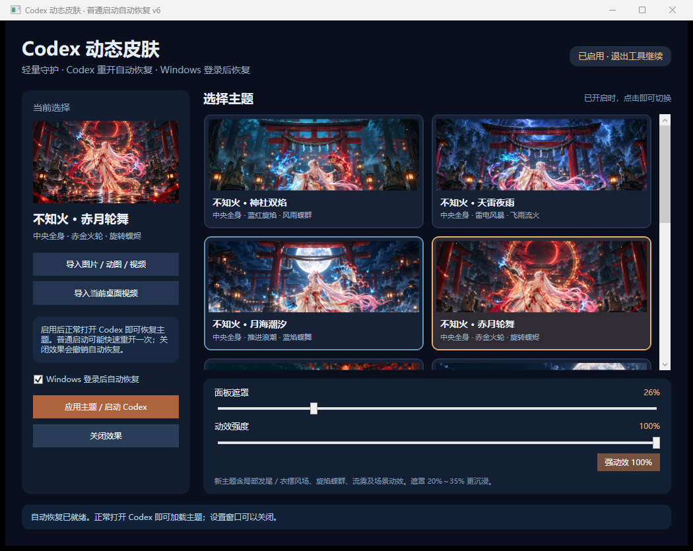

# Codex Theme Wallpaper

为 Windows 版 Codex 桌面软件添加可切换的沉浸式动态背景。使用 C# / .NET 8 / WPF，提供 10 套内置主题，并支持导入图片、GIF、MP4 和 WebM。

本项目为独立第三方主题工具。

## 下载与使用

当前版本 **v6.0.0**。从 [Releases](https://github.com/panjiale94/codex-theme-wallpaper/releases/latest) 下载 `CodexDreamSkin-v6-win-x64.zip`，完整解压到固定目录后运行 `CodexDreamSkin.exe`。请保留 `CodexDreamSkin.Worker.exe` 和 `Themes` 文件夹；发行版已包含 .NET 运行时。

1. 选择主题，点击“应用主题 / 启动 Codex”。
2. 首次升级若当前 Codex 已运行且没有主题连接，请从“文件 → 退出”退出一次，再从原来的普通入口打开。之后普通启动均自动恢复。
3. 关闭设置窗口后，后台守护继续维持皮肤。
4. 需要恢复时，重新打开工具，点击“关闭效果”。

新主题默认动效 100%，建议面板遮罩 20%～35%。[完整使用说明](outputs/CodexDreamSkin-v6/使用说明.md)。

## v6 普通启动自动恢复

- 修复 v5 只有专用快捷方式可靠恢复的问题：守护检测普通新启动，不依赖快捷方式是否携带主题参数。
- 对启动不超过 15 秒、路径属于 Codex 且资料目录匹配的主进程，自动快速重新启动一次，补齐本机主题连接参数。原始参数保留；带连接参数的进程不重复接管。
- 已经运行的旧客户端不被自动重启，避免中断当前工作。首次升级时需要退出再正常打开一次。
- Windows 登录后自动启动轻量守护，等待用户打开 Codex；可在界面取消勾选。
- 创建桌面及开始菜单恢复入口，并备份、接管可识别的已有 Codex 快捷方式。关闭效果时还原快捷方式、删除登录启动项并结束守护。
- 守护独立于 WPF 设置界面，媒体按 16 KB 分块传输，后台仅保留当前文件路径。
- 设置与页面记录保存到当前用户注册表，兼容旧版 JSON 设置迁移，避免加密目录的覆盖重命名问题。

本机样本：旧后台工作集约 222 MB；v6 等待约 49 MB，播放测试约 66～67 MB，私有提交约 14～31 MB。数值不包含 Codex 自身渲染/GPU 内存，随媒体和窗口数变化。强度 100% 时仍为 155 个背景粒子，保留 GPU 风场和原画质。[验收摘要](outputs/CodexDreamSkin-v6/验收结果.md)。

已直接使用不带调试参数的原生 Codex 可执行文件验证退出重开和登录后首次打开。Windows 登录恢复采用结束守护/客户端后再启动的模拟验证，没有实际重启用户电脑，也没有在真实 Store 应用列表入口上结束当前工作实例进行验收。

## 动态主题

| 主题 | 主要效果 |
| --- | --- |
| 不知火 · 神社双焰 | 中央全身人物、蓝红旋焰、火舌、蝶群、风雨 |
| 不知火 · 天雷夜雨 | 中央全身人物、快速斜雨、远景雷电、青紫流火 |
| 不知火 · 月海潮汐 | 中央全身人物、推进海浪、蓝焰蝶舞、海雾 |
| 不知火 · 赤月轮舞 | 中央全身人物、赤金火轮、旋转蝶群、余烬 |

另有离岛焰舞、月海流萤、樱雨花见、赤月蝶烬、银夜流光和极光幻境。



[四款强动效视频预览](outputs/CodexDreamSkin-v4/四款强动效预览.mp4)

人物发尾、衣摆和扇焰采用 GPU 局部风场；场景采用 Canvas 粒子、蝶群、旋焰、雨和浪潮。整个人物动作视频可通过导入 MP4 / WebM 实现。

## 构建

需要 Windows 和 .NET SDK 8 或更新版本。直接编译项目：

```powershell
dotnet build .\work\CodexDreamSkin\CodexDreamSkin.csproj -c Release
dotnet build .\work\CodexDreamSkin.Worker\CodexDreamSkin.Worker.csproj -c Release
```

Windows x64 自包含发布：

```powershell
powershell -NoProfile -ExecutionPolicy Bypass -File .\publish.ps1
```

启动生成的 `work/publish/CodexDreamSkin.exe`。根目录 `CodexThemeWallpaper.slnx` 可使用支持该格式的 .NET SDK / IDE 打开；已在 .NET SDK 10.0.401 编译通过。

## 源码结构

| 路径 | 用途 |
| --- | --- |
| `work/CodexDreamSkin/` | WPF 设置界面、后台守护、CDP 客户端及主题资源 |
| `work/CodexDreamSkin.Worker/` | 无 WPF 的守护及持久化 Codex 启动入口 |
| `work/CodexDreamSkin/NativeLaunchMonitor.cs` | 普通启动检测、资料目录核对与启动参数保留 |
| `work/CodexDreamSkin/SkinRuntime.js` | Codex 内部背景与透明面板样式 |
| `work/CodexDreamSkin/EffectRuntime.js` | GPU 局部风场与 Canvas 动画 |
| `work/CodexDreamSkin/Assets/` | 9 张主题插画与生成提示词 |
| `work/*.ps1`、`work/*.cjs` | 验收、截图、预览录制与诊断工具 |
| `tools/ffmpeg/SETUP.md` | 可选的动态预览编码工具准备方法 |
| `outputs/CodexDreamSkin-v6/` | 当前使用说明、验收摘要和界面预览 |
| `outputs/CodexDreamSkin-v4/` | 保留的强动效视频预览与旧版本资料 |

程序运行不需要 FFmpeg。可执行文件与源码包通过 Release 分发；编译缓存、测试客户端用户数据、历史开发归档和个人聊天界面截图在本地保存。

## 本机连接与限制

- 前台与后台使用当前 Windows 用户专用命名管道；后台仅连接本机 `127.0.0.1` 的 Codex 调试端口。
- 用户设置和连接记录保存在 `HKCU/Software/CodexDreamSkin/Profiles`，日志和快捷方式备份保存在 `%AppData%/CodexDreamSkin`。
- 不修改 Codex 的签名安装文件；Codex 界面结构更新后可能需要调整样式。
- 关闭设置窗口后保留一个轻量后台进程；Windows 登录启动可自行开关，登录后仅启动守护。
- 原生启动接管可能出现一次短暂重开。仅处理启动阶段：先请求关闭窗口，未退出时结束该新进程树，再用相同资料目录启动；超过 15 秒的旧进程不处理。
- Windows 登录启动若被系统或用户禁用，需重新启用；守护启动之前已运行超过 15 秒的 Codex 需要退出重开一次。
- 最小化或隐藏窗口时暂停特效绘制；GPU 风场不可用时保留原插画和 Canvas 特效。
- 自定义媒体单文件上限 100 MB，视频静音循环。Wallpaper Engine 场景包需先转换为视频才能导入。

主题插画由 AI 生成，部分采用《阴阳师》不知火的同人设计；角色和商标归其各自权利人。FFmpeg 相关资料遵循其对应的第三方许可证。
